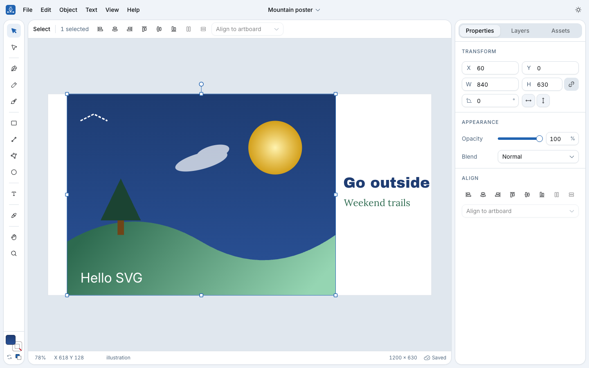

# Designer

A free, open source SVG editor in the style of Adobe Illustrator that runs entirely in your
browser. Draw logos, icons, badges, banners or any vector illustration, then export clean SVG,
PNG or JPG. No account and no server: your projects stay on your device.

**Open it at [designer.hfps.dev](https://designer.hfps.dev/)** (formerly LogoGo at logogo.hfps.dev,
which now redirects here).



## Features

- **Drawing tools:** select, direct select (node editing), pen, pencil, brush (real stylus
  pressure), line, rectangle, ellipse, polygon and star, text, eyedropper, hand and zoom.
- **Paths:** Bézier node editing (add, delete, corner and smooth points), join, reverse, simplify,
  outline stroke, booleans (unite, subtract, intersect, exclude), convert shapes to paths.
- **Color:** Illustrator-style fill and stroke swatches (X swaps, D resets), a color picker
  with hue, saturation, alpha, hex and RGB, document and recent colors, linear and radial gradients.
- **Type:** ten bundled open fonts, upload your own (TTF, OTF, WOFF, WOFF2), letter spacing,
  line height, alignment, create outlines.
- **Icons:** Lucide and Phosphor built in, plus every open-licensed Iconify collection, inserted as
  editable paths (click or drag onto the canvas).
- **Layout:** layers with drag and drop, groups, lock and hide, align and distribute, smart guides,
  rulers, grid with snapping, context menu on the canvas.
- **Files:** export SVG (text outlined), PNG and JPG at any scale; import SVG (Inkscape and
  Illustrator files, gradients, transforms, styles), paste or drop SVG and images, project files
  (`.designer.json`), autosave with a projects list, LogoGo projects migrated automatically.
- **Everywhere:** light and dark themes with color palettes, works offline (PWA), usable on a phone.

## Privacy

- Projects are saved in your browser (IndexedDB). Export a project file to back one up.
- Uploaded fonts never leave your device.
- No analytics, no ads. The only requests to another server go to the Iconify API, when you browse
  the Phosphor or Iconify icon libraries.

## Shortcuts

`⌘` is Ctrl on Windows and Linux. Help → Keyboard shortcuts (`⌘/`) lists them all.

| Tools | | Edit | |
| :--- | :--- | :--- | :--- |
| Select | `V` | Undo / redo | `⌘Z` / `⇧⌘Z` |
| Direct select | `A` | Copy / paste / duplicate | `⌘C` / `⌘V` / `⌘D` |
| Pen / pencil / brush | `P` / `N` / `B` | Group / ungroup | `⌘G` / `⇧⌘G` |
| Rectangle / ellipse / line | `M` / `L` / `\` | Bring forward / send backward | `⌘]` / `⌘[` |
| Text | `T` | Create outlines | `⇧⌘O` |
| Eyedropper | `I` | Swap fill and stroke / default | `X` / `D` |
| Hand / zoom | `H` (or Space) / `Z` | Fit / 100% | `⌘0` / `⌘1` |
| Edit points | `↵` or double-click | Grid / snap to grid | `⌘'` / `⇧⌘'` |

## For agents and scripts

Projects are plain JSON ([format](docs/project-format.md), [JSON Schema](https://designer.hfps.dev/schema/designer-project.schema.json)),
and the `designer` CLI creates, converts, checks and shares them without the browser:

```sh
bun run designer from-svg glyph.svg -o glyph.designer.json   # in this repo
bunx --bun github:henriquefps/logo-designer open glyph.designer.json   # anywhere: opens it in Designer
bun run designer present a.designer.json b.designer.json   # local gallery with an "Open in Designer" button per file
```

**Never paste `#open=` links into chat; they wrap and break.** Use `designer open` / `designer present`.
Outside this repo, pin the commit (`github:henriquefps/logo-designer#<sha>`): Bun caches unpinned `github:` specs and keeps running an old CLI. See [docs/agents.md](docs/agents.md).

Agents can learn the whole workflow from the bundled skill: `npx skills add henriquefps/logo-designer` (installs [`skills/designer`](skills/designer/SKILL.md)).

`designer link` prints `https://designer.hfps.dev/#open=…` links that carry a project or SVG and import it as a new project
after a confirmation; `?import=<url>` fetches one from a URL. In Chrome and Edge, ⌘S / Ctrl+S saves
back to the `.designer.json` you opened. The whole workflow: [`docs/agents.md`](docs/agents.md).

## Stack

Vite, React 19, TypeScript, Tailwind CSS 4 and shadcn/ui (Radix), zustand with immer for state
and undo, paper.js for geometry only (the SVG DOM renders the document), opentype.js for fonts,
perfect-freehand for the brush, Vitest. Hosted as a Cloudflare Worker with static assets.

## Develop

```sh
bun install
bun run dev      # http://localhost:5173
bun run test     # Vitest
bun run lint
bunx tsc -b
bun run build
```

- Spec: [`docs/rebuild-spec.md`](docs/rebuild-spec.md)
- Architecture and extension points (tools, actions, panels, dialogs, importers, exporters):
  [`docs/architecture.md`](docs/architecture.md)
- Deploy: [`docs/deploy.md`](docs/deploy.md)
- Project format and JSON Schema: [`docs/project-format.md`](docs/project-format.md) (`bun run schema` regenerates
  `public/schema/designer-project.schema.json` after changing `src/model/types.ts`)
- Agent workflow and the `designer` CLI: [`docs/agents.md`](docs/agents.md)
- App icon: `scripts/glyph.svg` → `NODE_PATH=<folder with sharp>/node_modules node scripts/build-icons.mjs scripts/glyph.svg docs/img --site public`.
  Social preview and Open Graph image: `scripts/social-preview.html` (render the page at
  1280 × 640 at 2×, and with `#og` at 1200 × 630 for `public/og-image.jpg`).

In development, `window.__designer` exposes the stores for browser tests.

## Contributing

Issues and pull requests are welcome at [github.com/henriquefps/logo-designer](https://github.com/henriquefps/logo-designer).
By contributing you agree that your work is licensed under AGPL-3.0-or-later.

## License

Designer is free software, licensed under the [GNU Affero General Public License v3.0 or later](LICENSE)
(AGPL-3.0-or-later). Copyright © 2026 [Henrique Silva](https://hfps.dev). Source code:
[github.com/henriquefps/logo-designer](https://github.com/henriquefps/logo-designer).

If you host a modified version as a service for other people, the AGPL requires you to publish
its source code to those users.

Third-party notices:

- The bundled fonts are under the SIL Open Font License 1.1 (license texts in
  [`src/fonts/files/licenses`](src/fonts/files/licenses)).
- [Lucide](https://lucide.dev/license) icons: ISC.
- [Phosphor](https://github.com/phosphor-icons/homepage/blob/master/LICENSE) icons: MIT.
- [Iconify](https://iconify.design/) icons keep each collection's own license (shown in the app).
