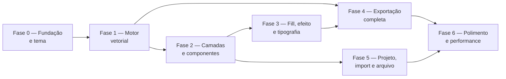

# LogoGo 2.0 — plano para uma ferramenta de identidade visual "nível Photoshop"

Levantamento do estado atual + roteiro de construção. Documento vivo — atualizar conforme fases forem fechadas.

## 1. Onde a LogoGo está hoje

Auditei o repositório antes de planejar. Hoje a LogoGo é um **editor de ícone único** (não de identidade visual completa):

- Canvas SVG único por projeto, com fundo sólido/gradiente/transparente em 4 formas (quadrado, rounded, squircle, círculo) que recorta os elementos de verdade — tanto no preview quanto no raster exportado.
- Quatro tipos de elemento, todos "flat" (sem grupos): `icon` (Lucide/Phosphor), `text`, `image`, `shape` (retângulo, elipse, linha, e um "path" que na verdade é uma polilinha reta — sem curvas Bézier).
- Seleção múltipla, marquee, snapping, guias de alinhamento, zoom/pan, undo/redo por projeto — já bem resolvidos ([useProjectStore.ts](src/store/useProjectStore.ts), [snapping.ts](src/lib/snapping.ts), [useCanvasZoomPan.ts](src/hooks/useCanvasZoomPan.ts)).
- Exportação: SVG, PNG/WebP/JPG em 256/512/1024, e um ZIP com favicons web + `AppIcon.appiconset` do iOS + mipmaps Android ([iconPack.ts](src/lib/export/iconPack.ts)). Sem macOS, sem PDF, sem tamanhos custom, sem variações de marca.
- Projetos múltiplos salvos em `localStorage`, com arquivo de backup exportável. Tudo client-side, sem conta, sem servidor — filosofia que vale a pena manter.
- Limitação documentada: fontes customizadas não sobrevivem à rasterização (o pipeline de export não alcança as regras `@font-face` da página).

Em resumo: é um ótimo **gerador de ícone de app**. Não é ainda uma ferramenta de **design de logotipo** — falta vetor de verdade (curvas, boolean ops), camadas/grupos, efeitos, tipografia avançada, múltiplas peças por marca (logo + ícone + wordmark + variações) e uma exportação que cubra as plataformas de verdade.

## 2. O que "quase um Photoshop" significa aqui

Photoshop é uma ferramenta de raster. O que faz sentido para logotipo é o equivalente vetorial — mais Illustrator/Figma do que Photoshop, mas o espírito da pergunta é claro: **profundidade de ferramenta profissional**, não um brinquedo de montar ícones. Vou tratar "completo" como:

- Vetor de verdade: caneta Bézier, edição de nós, boolean ops (união/subtração/interseção/exclusão).
- Camadas de verdade: grupos aninhados, bloqueio, opacidade e blend mode por camada, componentes reutilizáveis.
- Preenchimentos e efeitos: gradientes multi-stop em qualquer elemento, padrões, sombra/blur/contorno empilháveis.
- Tipografia séria: fonte customizada, eixos variáveis, texto em curva, outline de texto para path.
- Um **projeto de marca** com múltiplas peças (não um canvas único) — símbolo, logótipo horizontal, wordmark, versões clara/escura/mono — porque isso é o que "escritório de design completo" realmente entrega.
- Exportação que cobre toda plataforma de verdade, com os detalhes exatos de padding/tamanho que cada uma exige (seção 6).

Fora do escopo, deliberadamente: edição de fotos raster (pincel de cura, liquify, camadas de ajuste de foto), colaboração multiplayer em tempo real e contas na nuvem. Isso quebraria a promessa atual de "tudo roda no navegador, sem servidor" — se um dia isso mudar, é uma decisão separada, não um efeito colateral deste plano.

## 3. Decisões de arquitetura

**Motor de renderização: manter SVG como fonte da verdade, não migrar para canvas/WebGL.**
O SVG já é o formato de exportação nativo — manter o DOM SVG como modelo de dados evita uma camada de conversão com perda entre "o que edito" e "o que exporto" (WYSIWYG real). SVG nativo já cobre gradientes, padrões, filtros (`feGaussianBlur`, `feDropShadow`) e `mix-blend-mode` — dá pra ir bem mais longe com o que já existe antes de precisar trocar de motor. O que falta (boolean ops, edição de nós Bézier) entra como uma camada de **geometria pura** por cima (uma lib como `martinez-polygon-clipping` ou `paper.js` usada só para calcular o `d` do path resultante, sem renderizar nada com ela) — o SVG continua sendo desenhado do mesmo jeito de sempre.

**Tema: shadcn continua, mas com um `components.json` próprio, diferente do site atual.**
Hoje o site usa `style: radix-sera`, `baseColor: olive`, densidade "site de consumo". Uma ferramenta pro pede o oposto do que um site institucional pede: mais densidade de informação, toolbars compactas, dark-first (é assim que Figma, Illustrator e Photoshop tratam a própria UI — o canvas branco do usuário é que deve saltar aos olhos, não o chrome do app). Recomendo:
- `baseColor` neutro mais frio (`neutral` ou `zinc`) em vez de `olive`, com um accent próprio definido via variável CSS (não um dos base colors prontos) — separa visualmente do site institucional sem inventar um novo design system do zero.
- Raio de borda menor e paleta de espaçamento mais compacta que o tema atual, para caber toolbars, painel de camadas, e o inspector de propriedades sem parecer apertado.
- Isso é um projeto/tema `shadcn` separado — não um retheme do app atual por cima do existente.

## 4. Roadmap por fases

Cada fase é utilizável sozinha (dá pra parar entre elas), mas a ordem importa: a Fase 1 (motor vetorial) é pré-requisito de quase tudo depois.

### Fase 0 — Fundação do workspace
- Novo tema shadcn (seção 3) + shell de painéis redimensionáveis (canvas central, camadas à esquerda, propriedades à direita — layout "app pro", não "app de site").
- Modelo de dados: projeto passa a ter **múltiplas pranchas** (`boards`) em vez de um canvas único — ex.: "Símbolo", "Horizontal", "Wordmark", "Versão escura". É a mudança estrutural mais profunda do plano; todo o resto assume que ela existe.
- Réguas, guias arrastáveis a partir da régua, grade configurável — estende o [snapping.ts](src/lib/snapping.ts) que já existe.

### Fase 1 — Motor vetorial
- Caneta Bézier de verdade: `path` deixa de ser polilinha e passa a ter segmentos cúbicos, nó corner/smooth, alças de entrada/saída.
- Modo de edição de nó (duplo clique entra no path, arrasta âncora/alça, adiciona/remove nó).
- Boolean ops (união, subtração, interseção, exclusão) sobre qualquer combinação de shapes/ícones/texto.
- "Converter para path" em ícone, shape e texto — necessário para as boolean ops funcionarem em cima de ícone/texto, e resolve de quebra o bug das fontes customizadas no export (texto vira geometria antes de rasterizar, não depende mais de `@font-face` no canvas).
- Contorno com cap/join/dash e posição inside/center/outside (SVG só tem centro nativamente — inside/outside exigem gerar um path de offset).

### Fase 2 — Camadas e organização
- Painel de camadas de verdade: grupos aninhados, arrastar para reordenar, lock/hide por item e por grupo, opacidade e blend mode por camada.
- **Componentes**: definir um elemento (ex.: o símbolo da marca) como reutilizável e instanciá-lo em várias pranchas — editar o original atualiza todas as instâncias. É a feature que separa "editor de ícone" de "ferramenta de marca".
- Estilos salvos (cor, tipografia) reutilizáveis e atualizáveis em lote.

### Fase 3 — Preenchimento, efeito e tipografia
- Editor de gradiente linear/radial/cônico com múltiplos stops, em qualquer elemento (hoje só existe no fundo), com alças no próprio canvas.
- Preenchimento com padrão (repetir uma imagem/ícone).
- Pilha de efeitos por elemento (sombra externa, sombra interna, blur, empilháveis, como a lista de efeitos do Figma) via filtros SVG.
- Fonte customizada (upload de `.woff2`), controle de eixo variável, letter-spacing/line-height, texto em curva, outline de texto para path.
- **Brand kit**: paletas e pares de fonte nomeados, aplicáveis ao projeto inteiro, com variações (ex. "Primária", "Mono", "Invertida") que trocam todas as pranchas de uma vez.

### Fase 4 — Exportação completa
Ver as tabelas da seção 6 para as especificações exatas. Resumo do que muda:
- PNG em resolução customizada + densidades @1x/@2x/@3x, com ou sem fundo.
- SVG em dois modos: "editável" (mantém `<text>`/gradientes) e "achatado" (fontes viram path, ids/classes limpos) para portabilidade.
- PDF vetorial (uma prancha por página) para material impresso.
- Favicon `.ico` multi-resolução.
- iOS, Android (adaptive icon de verdade, não só mipmap), macOS `.icns` e menu bar — detalhe completo na seção 6.
- Presets de redes sociais (OG image, card do X, banner do LinkedIn) reaproveitando o conceito de prancha.
- "Exportar tudo" em lote, lembrando o último preset usado por projeto.

### Fase 5 — Projeto, import e arquivo
- Versionar o schema do projeto (pranchas, grupos, paths com boolean, brand kit) com migração automática dos projetos salvos no formato atual — ninguém perde trabalho na virada.
- Import de SVG (via elemento embutido no início; "converter para editável" como meta secundária para SVGs simples).
- Opcional: salvar direto em disco via File System Access API, mantendo a filosofia sem conta/sem servidor.

### Fase 6 — Polimento, performance e acessibilidade
- Estender a virtualização que já existe no grid de ícones ([useVirtualGrid.ts](src/hooks/useVirtualGrid.ts)) para pranchas com muitas camadas.
- Atalhos de teclado para os novos modos (edição de nó, boolean, navegação entre pranchas) — já há uma base boa em [useKeyboardShortcuts.ts](src/hooks/useKeyboardShortcuts.ts).
- Acessibilidade: foco visível em toolbar/painéis, e um verificador de contraste no brand kit (avisa se uma cor de marca falha o contraste contra o fundo declarado — diferencial de escritório de design de verdade).
- Confirmar que o PWA/offline continua saudável com o aumento de bundle (libs de boolean/pdf) via code-splitting por painel.

## 5. Sequenciamento e esforço

| Fase | Entrega principal | Tamanho | Depende de |
|---|---|---|---|
| 0 | Tema novo + pranchas múltiplas + réguas/guias | M | — |
| 1 | Caneta Bézier, edição de nó, boolean ops | G | Fase 0 |
| 2 | Camadas/grupos, componentes, estilos salvos | M | Fase 0 |
| 3 | Gradiente/padrão por elemento, efeitos, tipografia avançada, brand kit | G | Fase 1 |
| 4 | Exportação completa (todas as plataformas da seção 6) | M | Fases 1 e 3 |
| 5 | Migração de schema, import SVG, salvar em disco | M | Fase 2 |
| 6 | Performance, atalhos, acessibilidade | P | Fases 4 e 5 |

P = pequeno, M = médio, G = grande. A Fase 1 é a de maior risco técnico (geometria Bézier + boolean ops) — vale prototipar isolada antes de encaixar na UI.

## 6. Especificação de exportação

### macOS — `.icns` (ícone de app)

Confirmando o que você lembrava: **certo**. O canvas é 1024×1024, mas a arte visível deve ocupar só ~824×824 centralizados (cerca de 100px de respiro de cada lado) — porque o macOS aplica sua própria máscara de squircle, brilho e sombra por cima da arte. Exportar a arte "sangrando" até a borda faz o ícone final parecer maior/cortado depois que o sistema compõe a máscara.

Na prática: gera-se tudo a partir de **um único mestre em 1024×1024 com essa margem já embutida** — todos os tamanhos abaixo são apenas esse mestre reamostrado, então a margem relativa se propaga sozinha.

| Arquivo (pasta `.iconset`) | Pixels |
|---|---|
| icon_16x16.png | 16 |
| icon_16x16@2x.png | 32 |
| icon_32x32.png | 32 |
| icon_32x32@2x.png | 64 |
| icon_128x128.png | 128 |
| icon_128x128@2x.png | 256 |
| icon_256x256.png | 256 |
| icon_256x256@2x.png | 512 |
| icon_512x512.png | 512 |
| icon_512x512@2x.png | 1024 |

(`iconutil` empacota essa pasta em `.icns`; ou geramos o `.icns` diretamente no navegador com um encoder pequeno, sem depender de ferramenta nativa da Apple.)

### macOS — ícone de menu bar / status item

Também confirmando: **44×44 ou 22×22 está certo**. Aqui a lógica é diferente do ícone de app — é uma "template image": forma preta sólida sobre fundo transparente, sem cor própria, para o AppKit tingir automaticamente conforme o tema claro/escuro e o estado (hover/ativo). Desenhado a 22×22pt:

| Arquivo | Densidade | Pixels |
|---|---|---|
| `NomeTemplate.png` | @1x | 22×22 |
| `NomeTemplate@2x.png` | @2x | 44×44 |

(Sem @3x — Mac não tem tela 3x. É diferença real em relação ao iOS.)

### iOS — `AppIcon.appiconset`

O pipeline atual já gera o set completo multi-tamanho (correto para compatibilidade ampla), mas vale oferecer também o modo moderno: desde o Xcode 14, a Apple aceita **um único ícone 1024×1024** no asset catalog (o sistema deriva os demais tamanhos). Proposta: manter o set completo como opção "legado/compatibilidade" e adicionar o modo "somente 1024" como padrão novo — mais simples e é o que a Apple recomenda hoje.

### Android — ícone adaptativo (não só mipmap)

O pipeline atual gera mipmaps quadrados/redondos fixos — o Android moderno espera um **ícone adaptativo**: camada de primeiro plano + camada de fundo separadas (e opcionalmente uma versão monocromática para o "ícone temático" do Android 13+), compostas pelo sistema com a máscara que cada fabricante/launcher escolhe (círculo, squircle, quadrado arredondado...).

| Elemento | Tamanho do canvas | Zona segura (sempre visível) |
|---|---|---|
| Camada foreground/background | 108×108dp | — |
| Conteúdo garantido visível | — | círculo de ~66dp de diâmetro, centralizado |

(1dp = 1px em mdpi; em xxxhdpi isso vira 432×432px de canvas com ~264px de zona segura. Gerar a partir do mestre vetorial evita ter que calcular cada densidade manualmente.) Mantém-se também o `mipmap` legado + `ic_launcher_round` + ícone de 512 para a Play Store, como já existe hoje.

### Web, PWA e favicon

| Uso | Formato | Tamanhos |
|---|---|---|
| Favicon multi-resolução | `.ico` | 16, 32, 48 (um único arquivo container) |
| Favicon moderno | `.png`/`.svg` | 16, 32, SVG escalável |
| Apple touch icon | `.png` | 180 |
| Manifest PWA | `.png` | 192, 512 (+ variante "maskable" com padding de segurança) |
| OG image | `.png`/`.jpg` | 1200×630 |
| Card do X | `.png`/`.jpg` | 1200×675 |
| Banner do LinkedIn | `.png`/`.jpg` | 1584×396 |

### PNG genérico e vetor

| Uso | Formato | Notas |
|---|---|---|
| Raster sob demanda | PNG/WebP/JPG | tamanho customizado livre, além dos presets 256/512/1024 já existentes; opção @1x/@2x/@3x a partir de um tamanho-base |
| SVG editável | `.svg` | preserva `<text>`, gradientes, ids |
| SVG achatado | `.svg` | fontes convertidas em path, sem ids/classes — para portabilidade e evitar dependência da fonte no destino |
| Impresso | `.pdf` | vetorial, uma prancha por página |
| Windows | `.ico` | multi-tamanho (16/32/48/256), opcional tile de Start Menu |

## 7. Bibliotecas candidatas (apêndice técnico)

- **Boolean ops / geometria de path**: `martinez-polygon-clipping` (leve, robusto para polígonos) ou `paper.js` (mais completo, inclui a própria matemática de Bézier) — usados só para calcular geometria, nunca para renderizar.
- **Outline de fonte para path**: `opentype.js` — lê o `.woff2`/`.ttf` carregado e devolve os contornos como path SVG; resolve o bug de fonte no export "de graça".
- **PDF vetorial**: `pdf-lib` (gera PDF diretamente no navegador, sem servidor).
- **`.icns` e `.ico`**: não precisam de lib pesada — são containers simples (lista de PNGs com um cabeçalho); um encoder pequeno e dedicado resolve, na linha do que [iconPack.ts](src/lib/export/iconPack.ts) já faz hoje.
- **Empacotamento**: `jszip`, que já está no projeto — mantém.

## 8. O que fica de fora por enquanto

- Edição de foto raster (pincel de cura, liquify, camadas de ajuste) — fora do escopo de uma ferramenta de identidade visual.
- Colaboração multiplayer em tempo real e contas na nuvem — mudaria a promessa atual de "tudo no navegador, sem servidor"; se quiser isso um dia, tratar como decisão separada, não consequência deste plano.
- Import de arquivos `.ai`/`.psd` — complexidade de parsing desproporcional ao ganho; import de SVG cobre a maior parte do caso de uso real.
